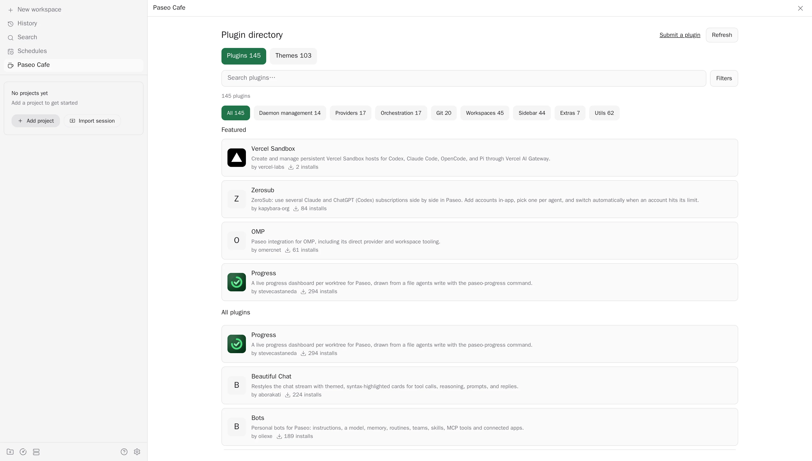
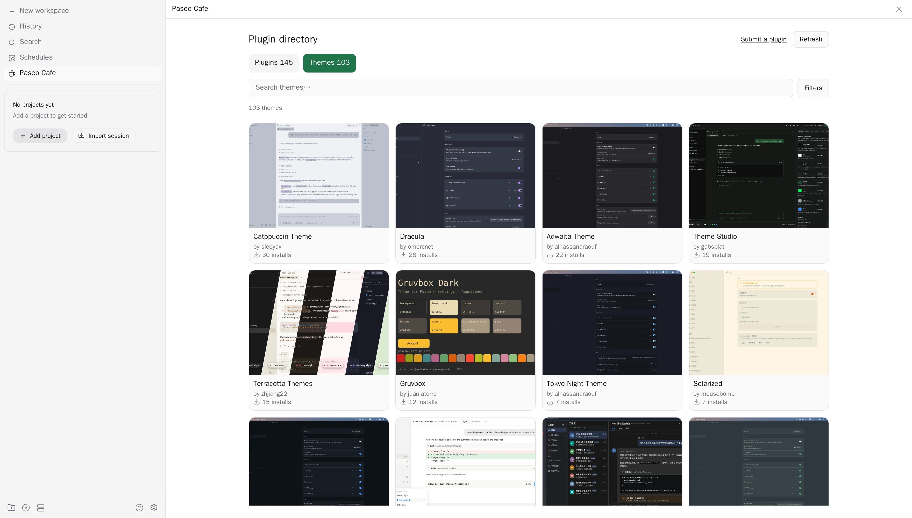
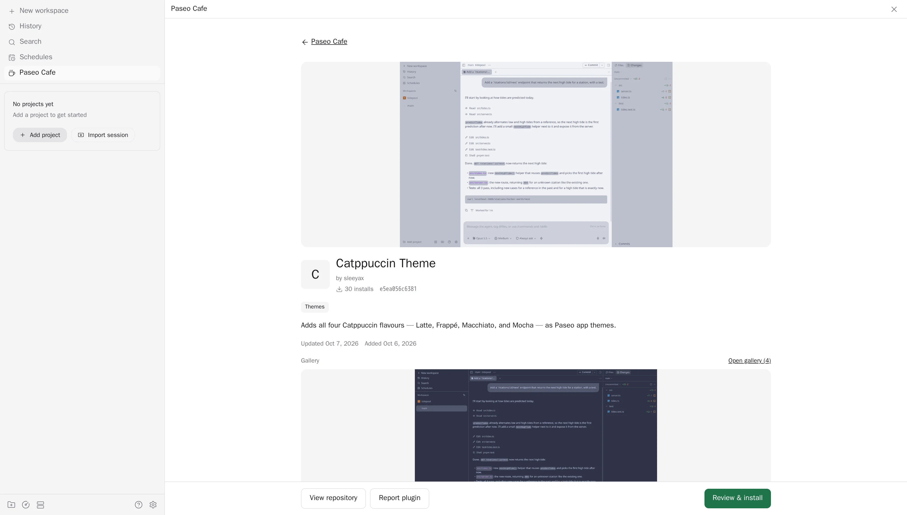
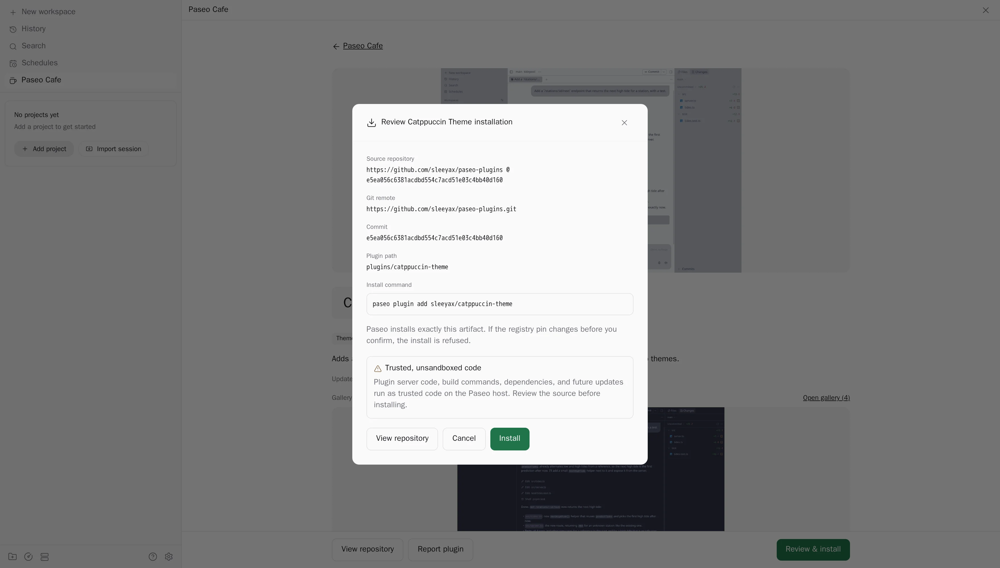
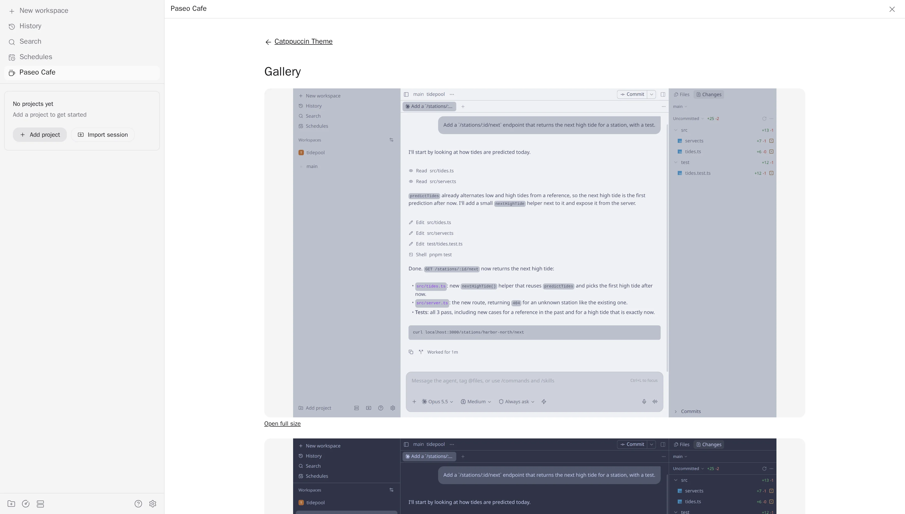

# Paseo Cafe

Browse the official [Paseo plugin directory](https://paseo.sh/plugins) from inside Paseo, and
install plugins without leaving the app.

The plugin adds a **Paseo Cafe** sidebar surface that lists every plugin in the directory with its
description, author, categories, install count, screenshots, and README. Featured plugins and the
most recently updated ones lead the default view; search, category, installation-state, and sort
controls narrow it down. Installs run `paseo plugin add owner/slug` on the daemon host behind a
confirmation step that shows the exact reviewed package or Git commit, so Paseo installs the
artifact the directory approved and nothing else. A **Paseo plugin** composer attachment source can
attach a plugin's listing to a prompt for agent review before you trust it.

Update availability comes from `paseo plugin update --all --check`, so it follows the same rules as
the CLI: a plugin installed from the directory moves to the directory's current pin, and one
installed from npm or Git moves to its source's latest release. The sidebar shows a badge when
updates are available.

Automatic updates are on by default for every plugin. Turn them off per installation from the
plugin detail page when a plugin should stay put; Cafe checks shortly after startup and every six
hours, isolates failures between plugins, and rechecks your choice before each update.
Cafe updates itself through a restart-safe detached handoff. **Settings → Plugins → Paseo Cafe →
Run now** runs the policy immediately.

## Screenshots

### Browse the plugin directory



### Browse themes



### Inspect a listing



### Review the exact artifact before installing



### Browse a listing's screenshot gallery



## Install

```bash
paseo plugin add paseo-cafe/cafe
```

Requires Paseo 0.11.0-beta.4 or later: the daemon needs to resolve `owner/slug` directory ids. The
manifest declares `requirements.paseo` as `>=0.11.0-beta.4`. The prerelease comparator is required
because npm semver rules do not match `0.11.0-beta.4` with a plain `>=0.11.0` range.

By default the directory is read from `https://plugins.paseo.sh/index.json`. **Settings → Plugins →
Paseo Cafe** can point at another registry that serves the
[Paseo registry protocol v1](https://github.com/getpaseo/plugins/blob/main/PROTOCOL.md) documents.
A custom registry must use HTTPS, or HTTP on loopback (`localhost`, `*.localhost`, `127.0.0.0/8`,
`[::1]`). The registry picks which package or Git commit the install button hands to the `paseo`
CLI, so anyone able to rewrite a plaintext response chooses what gets installed on the daemon host.

The daemon resolves `owner/slug` only against its own default registry, or `host/owner/slug`
against a registry at a host root over HTTPS. For a registry served under a path prefix, or over
loopback HTTP, set `PASEO_PLUGIN_REGISTRY` in the daemon's environment and install from the CLI;
Cafe shows that instead of an install button.

## Limitations

- Listed plugins are community-submitted and reviewed by the directory maintainers. They are still
  trusted, unsandboxed code on your daemon host: read the source before installing.
- Installing shells out to the `paseo` CLI, so that binary must be on the daemon's `PATH`.
- Directory responses are cached on the daemon for five minutes. **Refresh** bypasses that cache.
- Plugins installed from npm or Git before the directory existed have no directory identity. Cafe
  recognizes them by package name, or by Git remote and plugin path, and shows them as installed.
